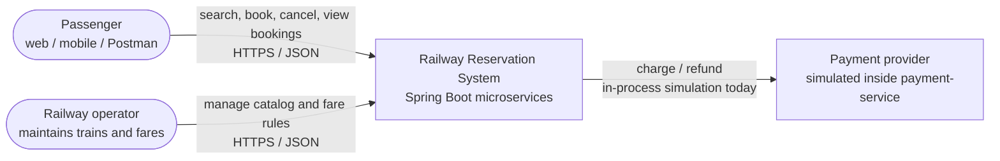
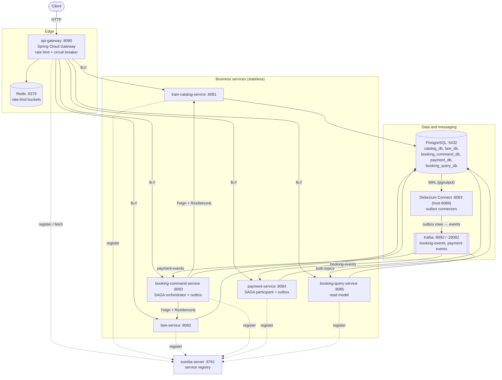
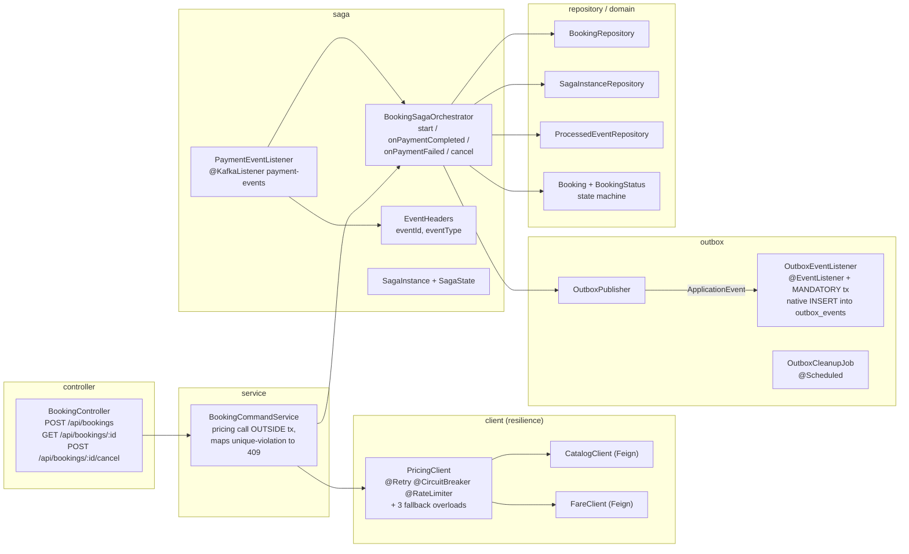
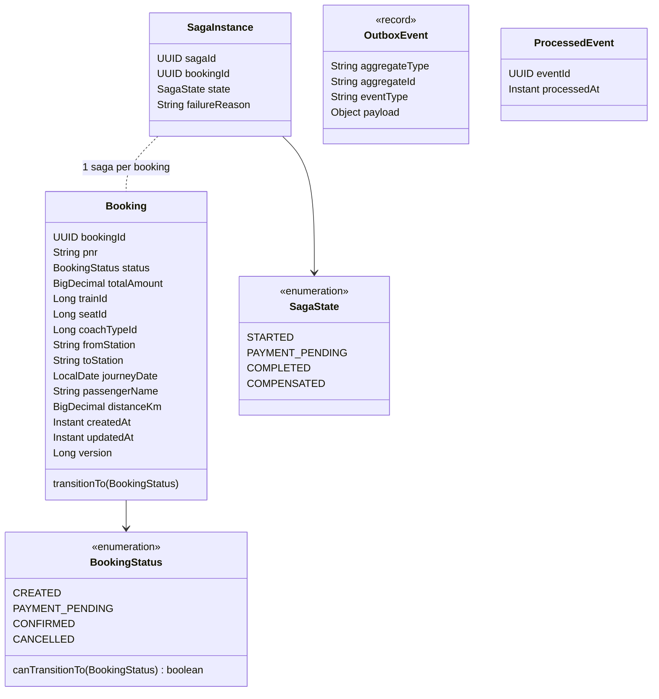
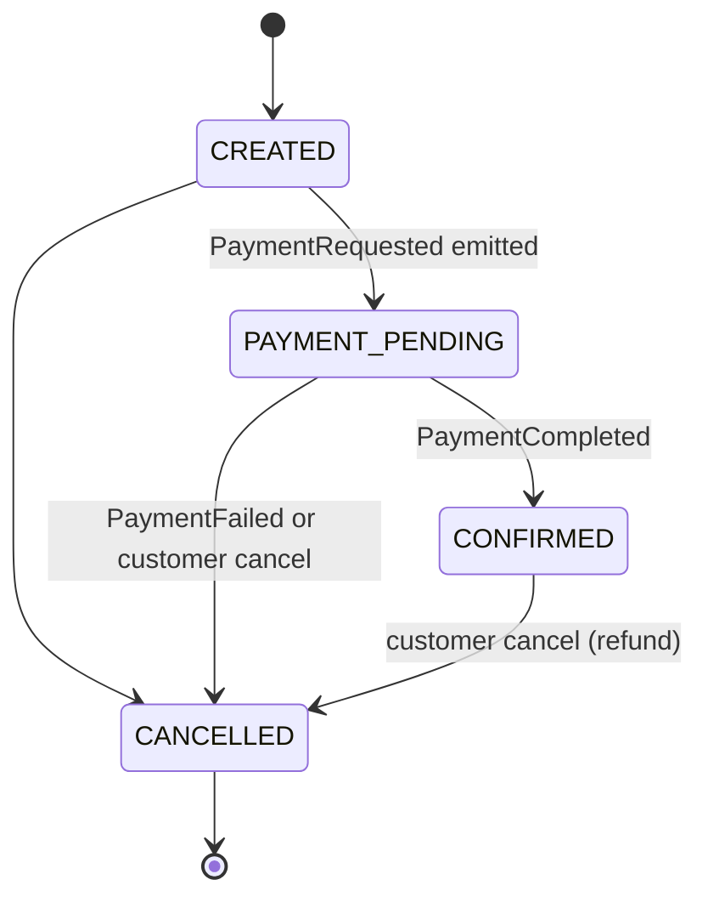
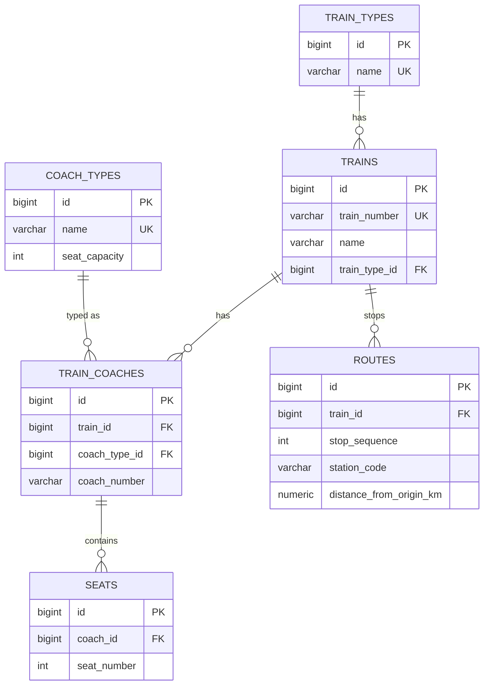
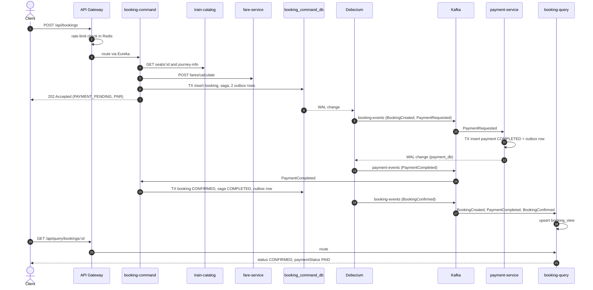
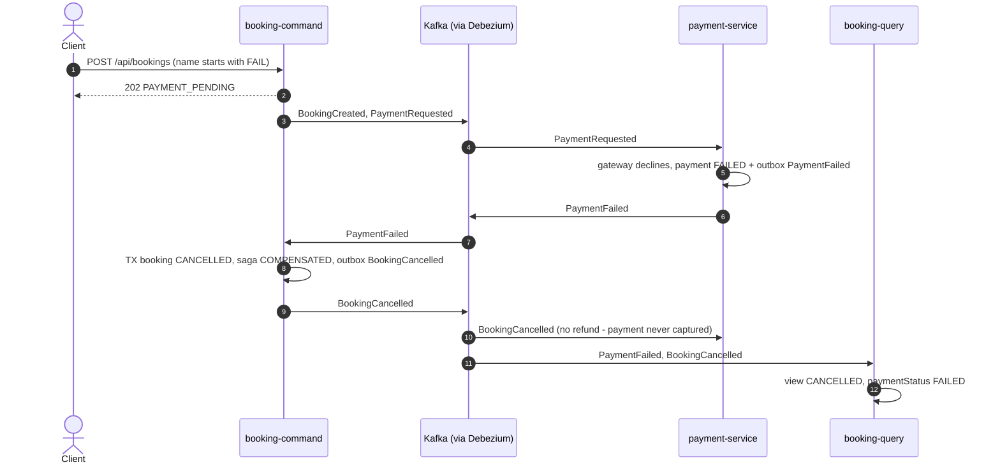

# Railway Reservation System

A cloud-native, event-driven **railway ticket reservation platform** built as Spring Boot 3 microservices.
It demonstrates how to keep several independently-owned databases consistent **without distributed transactions**, using
a **SAGA orchestrator**, the **Transactional Outbox** pattern, **Debezium CDC → Apache Kafka**, and **CQRS**, behind an
**API Gateway** with **rate limiting** and **circuit breakers**, with services discovered through **Eureka**.

| | |
|---|---|
| **Language / Runtime** | Java 21 (records, pattern-matching `switch`, virtual threads) |
| **Frameworks** | Spring Boot 3.3.5, Spring Cloud 2023.0.3, Spring Data JPA, Spring Kafka, Flyway |
| **Resilience** | Resilience4j (Circuit Breaker, Retry, Rate Limiter, Time Limiter) |
| **Messaging / CDC** | Apache Kafka (Confluent 7.6), Debezium 2.7 PostgreSQL connector + Outbox EventRouter |
| **Data** | PostgreSQL 16 (database-per-service), Redis 7 (gateway rate-limit counters) |
| **Build / Run** | Maven multi-module, Docker multi-stage build, Docker Compose |

> **Status:** reference / learning implementation. Business flows, resilience and messaging are fully implemented.
> Security (authN/Z, TLS), multi-broker Kafka, HA Postgres and observability stacks are **not** included and are listed as
> hardening items in [§14](#14-known-limitations-and-roadmap). Performance numbers in this document are **design targets**,
> not benchmark results.

---

## Table of Contents

1. [Repository layout](#1-repository-layout)
2. [High-Level Design (HLD) – C4 Levels 1 & 2](#2-high-level-design-hld--c4-levels-1--2)
3. [Low-Level Design (LLD) – C4 Levels 3 & 4](#3-low-level-design-lld--c4-levels-3--4)
4. [Microservice deep dives (six-parameter analysis)](#4-microservice-deep-dives-six-parameter-analysis)
5. [End-to-end workflows](#5-end-to-end-workflows)
6. [Design patterns used](#6-design-patterns-used)
7. [How the key patterns are implemented](#7-how-the-key-patterns-are-implemented)
8. [Running locally](#8-running-locally)
9. [Testing guide](#9-testing-guide)
10. [API reference](#10-api-reference)
11. [Event catalogue](#11-event-catalogue)
12. [Configuration reference](#12-configuration-reference)
13. [Troubleshooting](#13-troubleshooting)
14. [Known limitations and roadmap](#14-known-limitations-and-roadmap)

---

## 1. Repository layout

```
Railway-reservation-system/
├── pom.xml                         # Parent POM (Boot 3.3.5, Spring Cloud 2023.0.3, Resilience4j BOM, Lombok processor)
├── Dockerfile                      # Shared multi-stage build:  --build-arg MODULE=<module>
├── docker-compose.yml              # Postgres, Zookeeper, Kafka, Debezium, Redis, Eureka, Gateway, 5 services, connector-init
├── scripts/
│   ├── init-databases.sql          # Creates one logical DB per service
│   └── create-debezium-connector.sh# Registers the 2 Debezium outbox connectors (idempotent PUT)
├── eureka-server/                  # Service registry                         :8761
├── api-gateway/                    # Edge: routing, rate limit, circuit breaker :8080
├── train-catalog-service/          # Master data: trains, coaches, seats, routes :8081
├── fare-service/                   # Fare rules and fare calculation           :8082
├── booking-command-service/        # CQRS write side + SAGA orchestrator + outbox :8083
├── payment-service/                # SAGA participant (payments, refunds) + outbox :8084
└── booking-query-service/          # CQRS read side (projection from Kafka)    :8085
```

Package convention: `com.railway.<service>` with `domain`, `repository`, `service`, `controller`, and, where relevant,
`saga`, `outbox`, `client`, `messaging`/`projection`, `config`.

---

## 2. High-Level Design (HLD) – C4 Levels 1 & 2

The [C4 model](https://c4model.com) describes software at four zoom levels: **Context → Containers → Components → Code**.
Levels 1–2 are the HLD (this section); levels 3–4 are the LLD ([§3](#3-low-level-design-lld--c4-levels-3--4)).

### 2.1 C4 Level 1 – System Context

*Who uses the system and which external systems does it touch?*



| Actor / system | Interaction |
|---|---|
| Passenger | Creates bookings, cancels them, reads booking status (eventually consistent read model). |
| Railway operator | Creates train types, coach types, trains, coaches (seats are auto-generated), routes, fare rules. |
| Payment provider | Replaced by `PaymentGateway` (a simulator). Swap this class for a real PSP client without touching the SAGA. |

### 2.2 C4 Level 2 – Containers

*The deployable units and how they talk.*



**Key architectural decisions**

| Decision | Rationale |
|---|---|
| **Database per service** | Services own their schema; no cross-service joins or shared tables. Here: one Postgres *server*, five *databases* (split to separate servers in production). |
| **Synchronous only for pricing** | Booking needs seat, distance and fare immediately to quote a price → REST (Feign) with resilience. Everything after that is asynchronous. |
| **Asynchronous SAGA over Kafka** | Payment and confirmation are decoupled from the HTTP request; the API returns `202 Accepted`. |
| **Outbox + CDC instead of dual-write** | Writing to DB *and* Kafka in one request can lose or duplicate events. The outbox row commits atomically with the state change; Debezium publishes it from the WAL. |
| **CQRS** | Reads (status lookup, search) scale and evolve separately from writes; the read model is denormalised. |
| **Orchestration (not choreography)** | `booking-command-service` owns the SAGA state, so the workflow is explicit and easy to reason about. |

### 2.3 Runtime topology (Docker Compose)

```
railway-net (bridge)
 ├─ postgres  ── wal_level=logical, init-databases.sql
 ├─ zookeeper ── kafka ── debezium(connect)      connector-init (one-shot, registers connectors)
 ├─ redis
 ├─ eureka-server ──► api-gateway
 └─ train-catalog, fare, booking-command, payment, booking-query   (depend on postgres+kafka+eureka healthy)
```

| Component | Container port | Host port |
|---|---|---|
| api-gateway | 8080 | **8080** |
| eureka-server | 8761 | **8761** |
| train-catalog / fare / booking-command / payment / booking-query | 8081 / 8082 / 8083 / 8084 / 8085 | *(not published – reach them through the gateway)* |
| Debezium Connect REST | 8083 | **8089** |
| PostgreSQL | 5432 | **5432** |
| Kafka (external listener) | 9092 | **9092** (containers use `kafka:29092`) |
| Redis | 6379 | *(not published)* |

---

## 3. Low-Level Design (LLD) – C4 Levels 3 & 4

### 3.1 C4 Level 3 – Components of `booking-command-service`

The most complex container; the others follow the same layering.



**Component responsibilities**

| Component | Responsibility |
|---|---|
| `BookingController` | HTTP mapping, Bean Validation (`@Valid`), returns `202 Accepted` on create. |
| `BookingCommandService` | Obtains a price quote via `PricingClient` **before** opening any DB transaction (never hold a connection while calling remote services), then starts the SAGA. Converts `DataIntegrityViolationException` (seat taken) to **409 Conflict**. |
| `PricingClient` | Calls catalog (`/seats/{id}`, `/trains/{id}/journey-info`) and fare (`/calculate`). Wrapped by Retry → CircuitBreaker → RateLimiter; fallbacks translate failures into 4xx/503. |
| `BookingSagaOrchestrator` | Single transactional boundary for every SAGA step: state change + saga state + outbox rows. Idempotent via `processed_events`. |
| `PaymentEventListener` | Consumes `payment-events`; dispatches `PaymentCompleted` / `PaymentFailed`; swallows duplicates. |
| `OutboxPublisher` / `OutboxEventListener` | Domain code publishes an in-process `OutboxEvent`; the listener (propagation `MANDATORY`) inserts the row **inside the caller's transaction**. |
| `OutboxCleanupJob` | Purges outbox rows older than 1 h every 10 min (Debezium reads the WAL, not the table). |
| `KafkaConfig` | Declares topics (3 partitions, RF 1) and a `DefaultErrorHandler` (5 retries, 1 s apart). |

### 3.2 C4 Level 3 – Components of other containers

| Container | Components |
|---|---|
| **api-gateway** | `GatewayApplication` · `GatewayConfig` (`KeyResolver` bean `ipKeyResolver`, Resilience4j default `Customizer`) · `FallbackController` (`/fallback/{service}` → JSON 503) · `application.yml` (5 routes, default `RequestRateLimiter` filter, per-route `CircuitBreaker` + `Retry`). |
| **train-catalog-service** | `CatalogController` → `CatalogService` → `Repositories` (6 Spring Data repos) → `Entities` (TrainType, CoachType, Train, TrainCoach, Seat, Route) · `Dtos` (request/response records, `JourneyInfo`, `SeatInfo`). |
| **fare-service** | `FareController` → `FareService` → `FareRuleRepository` → `FareRule` · `FareDtos`. |
| **payment-service** | `BookingEventListener` (`@KafkaListener booking-events`) → `PaymentService` → `PaymentGateway` (simulator) · `PaymentRepository` · `ProcessedEventRepository` · outbox package (same design as booking-command) · `PaymentController`. |
| **booking-query-service** | `BookingEventsListener` (`@KafkaListener` on both topics) → `BookingProjector` → `BookingViewRepository` · `BookingQueryController`. |

### 3.3 C4 Level 4 – Code (domain model and state machines)



**Booking state machine** (enforced in `BookingStatus.canTransitionTo`; illegal transitions throw `IllegalStateException`)



**SAGA state** (`saga_instances.state`): `STARTED → PAYMENT_PENDING → COMPLETED` (happy) or `→ COMPENSATED` (failure / cancel).

### 3.4 Database design



| Database | Tables | Notes |
|---|---|---|
| `catalog_db` | `train_types`, `coach_types`, `trains`, `train_coaches`, `seats`, `routes` | Unique `(train_id, coach_number)`, `(coach_id, seat_number)`, `(train_id, stop_sequence)`, `(train_id, station_code)`. Seeded by Flyway `V2`. |
| `fare_db` | `fare_rules` (`train_type_id`, `coach_type_id`, `constant_fare`, `fare_per_km`) | Unique `(train_type_id, coach_type_id)`. 3×3 seeded rules. |
| `booking_command_db` | `bookings`, `saga_instances`, `outbox_events`, `processed_events` | **Partial unique index** `uq_active_seat (train_id, journey_date, seat_id) WHERE status <> 'CANCELLED'` prevents double-booking. `bookings.version` = optimistic lock. |
| `payment_db` | `payments`, `outbox_events`, `processed_events` | `payments.booking_id` unique → one payment per booking. |
| `booking_query_db` | `booking_view`, `processed_events` | Denormalised read model; indexes on `pnr`, `lower(passenger_name)`, `status`. |

`outbox_events` (identical in `booking_command_db` and `payment_db`):

| Column | Type | Purpose |
|---|---|---|
| `id` | UUID PK | Becomes the Kafka header `eventId` (idempotency key). |
| `aggregate_type` | varchar | Routing key: `booking` → `booking-events`, `payment` → `payment-events`. |
| `aggregate_id` | varchar | Kafka message key (booking id) → per-booking ordering. |
| `event_type` | varchar | Becomes the Kafka header `eventType`. |
| `payload` | JSONB | Becomes the Kafka message value. |
| `created_at` | timestamptz | Used by the cleanup job. |
| `processed` | boolean | Present per the data-model requirement; CDC does not need it (see §14). |

### 3.5 Seed data (Flyway)

| Item | Values |
|---|---|
| Train types (ids) | `EXPRESS`=1, `SUPERFAST`=2, `RAJDHANI`=3 |
| Coach types (ids, seats) | `SLEEPER`=1 (72), `AC3`=2 (64), `AC2`=3 (48) |
| Train 1 | `12951 Mumbai Rajdhani` (RAJDHANI) – coaches `A1` (AC3, id 1), `B1` (AC2, id 2), `S1` (SLEEPER, id 3); seats auto-generated |
| Train 2 | `12009 Shatabdi Express` (SUPERFAST) – no coaches (used in the *wrong train* negative test) |
| Route of train 1 | `MMCT` 0 km → `BRC` 392 → `RTM` 655 → `KOTA` 919 → `NDLS` 1384 |
| Fare rules | `constant_fare = 50 + trainTypeId×10 + coachTypeId×20`, `fare_per_km = 0.5 + coachTypeId×0.4` |

**Worked example** – RAJDHANI (3) / AC3 (2), `MMCT → NDLS` = 1384 km:
`constant = 50+30+40 = 120`, `per km = 0.5+0.8 = 1.3` → `120 + 1384 × 1.3 = 1919.20`.
`MMCT → BRC` = 392 km → `120 + 392 × 1.3 = 629.60`.

---

## 4. Microservice deep dives (six-parameter analysis)

> Targets are proposed SLOs for a production deployment of this design, not measured results.

### 4.1 Eureka Server (`eureka-server`, :8761)

**1. Primary purpose & key responsibilities**
- Service registry: instances register on startup, send heartbeats, and de-register on shutdown.
- Lets the gateway (`lb://service-name`) and Feign clients (`name = "fare-service"`) resolve logical names to live instances – no hard-coded hosts.
- Provides a dashboard (`/`) and REST registry (`/eureka/apps`) for inspection.
- Evicts dead instances (`eviction-interval-timer-in-ms: 5000`).

**2. Measuring success (KPIs)**
| KPI | Target |
|---|---|
| Registered apps vs expected (6) | 100 % |
| Time for a new instance to become discoverable | < 30 s (client registry refresh interval) |
| Stale (dead but registered) instances | 0 beyond the eviction window |
| Registry availability | ≥ 99.9 % |

**3. Data flow, response times & failure impact**
- *Flow:* service → `POST /eureka/apps/{app}` (register) → periodic `PUT` heartbeat → clients periodically fetch registry deltas and **cache them locally**.
- *Latency:* register/heartbeat/fetch are small payloads (< 50 ms). Lookups at call time are local-cache reads (no network).
- *Failure impact:* **Medium.** If Eureka is down, services and the gateway keep routing using their cached registry; new/restarted instances cannot register and dead instances are not evicted. Booking continues to work for already-discovered instances.

**4. Technologies, advantages & limitations**
- `spring-cloud-starter-netflix-eureka-server`.
- ✅ Native Spring integration, client-side caching (AP system), trivial setup.
- ⚠️ Single node here (no peer replication); up to ~30 s propagation lag; self-preservation is **disabled** for fast eviction in dev (can evict healthy nodes during a network partition); less common in Kubernetes-native stacks than platform discovery.

**5. Scalability & performance targets**
- Registry is tiny (6 apps); one node handles hundreds of instances. For HA run ≥ 2–3 peers across zones (`defaultZone` listing peers).
- Target: heartbeat processing p95 < 50 ms; supports 500+ instances/node.

**6. Security, reliability & compliance**
- *Today:* unauthenticated; network-level isolation only.
- *Production:* protect with Spring Security (basic auth or mTLS) and keep it on a private network; re-enable self-preservation; run peers.
- *Compliance:* holds no PII or business data.

---

### 4.2 API Gateway (`api-gateway`, :8080)

**1. Primary purpose & key responsibilities**
- Single public entry point; routes `/api/catalog/**`, `/api/fares/**`, `/api/bookings/**`, `/api/payments/**`, `/api/query/**` to services via Eureka (`lb://`).
- **Rate limiting** per client IP (Redis token bucket).
- **Circuit breaker + fallback** per route (Resilience4j) → JSON `503` from `/fallback/{service}`.
- **Retry** (GET only, catalog and query routes) on 502/503 with exponential back-off.
- **Metrics** (`spring.cloud.gateway.metrics.enabled`, Prometheus endpoint, `/actuator/gateway/routes`).

**2. Measuring success (KPIs)**
| KPI | Target |
|---|---|
| Gateway-added latency | p95 < 20 ms |
| Availability | ≥ 99.95 % |
| Fallback (circuit-open) responses | < 0.1 % of traffic in steady state |
| 429 ratio | Tracks abusive clients only (< 1 % of legitimate traffic) |
| Route success rate | ≥ 99.5 % per route |

**3. Data flow, response times & failure impact**
- *Flow:* request → `RequestRateLimiter` (Redis Lua script, ~1–2 ms) → route match → `CircuitBreaker` → load-balanced call → response.
- *Failure impact:* **High (SPOF unless replicated)** – if the gateway is down, no external client can reach the system. Redis down → the limiter **fails open** (requests allowed). Downstream down → after failures reach the threshold the breaker opens and the gateway answers `503` immediately instead of waiting for time-outs.

**4. Technologies, advantages & limitations**
- Spring Cloud Gateway (reactive/Netty), Resilience4j reactor circuit breaker, Spring Data Redis Reactive, Micrometer Prometheus, Eureka client + Spring Cloud LoadBalancer.
- ✅ Non-blocking, rich filter chain, global (cluster-wide) rate limits via Redis, per-route resilience.
- ⚠️ Redis is an extra dependency; the key resolver uses the remote IP (behind a proxy/NAT use `X-Forwarded-For`); no authentication yet; POST routes are intentionally not retried (not idempotent).

**5. Scalability & performance targets**
- Stateless; scale horizontally behind an L4/L7 load balancer. Rate-limit state lives in Redis so limits stay global.
- Design target: ≥ 2,000 req/s per instance on 2 vCPU for pass-through traffic.
- Limits: `replenishRate 50/s`, `burstCapacity 100`, `requestedTokens 1`. Breaker: window 20, min 10 calls, 50 % failure, 15 s open, 5 half-open calls; time limiter 8 s.

**6. Security, reliability & compliance**
- *Today:* no authentication, no TLS, actuator endpoints (`prometheus`, `gateway`) exposed – dev setup.
- *Production:* TLS termination, OAuth2/JWT validation at the gateway (`spring-boot-starter-oauth2-resource-server`), CORS policy, request-size limits, restrict actuator, `X-Forwarded-For` key resolver, security headers.
- *Reliability:* time limiter + breaker + retry as above.
- *Compliance:* access logs must not include PII or tokens.

---

### 4.3 Train Catalog Service (`train-catalog-service`, :8081)

**1. Primary purpose & key responsibilities**
- System of record for **train types, coach types, trains, coaches, seats, routes**.
- Adding a coach **auto-generates its seats** from the coach-type capacity.
- Computes journey distance between two stations (`journey-info`) and resolves a seat to its coach/coach-type/train (`seats/{id}`) for booking validation.

**2. Measuring success (KPIs)**
| KPI | Target |
|---|---|
| `journey-info` / `seat` p95 latency | < 50 ms |
| Availability | ≥ 99.9 % |
| Data integrity violations (orphan/duplicate rows) | 0 (DB constraints) |
| 5xx rate | < 0.1 % |

**3. Data flow, response times & failure impact**
- *Callers:* operators via gateway; `booking-command-service` via Feign (2 calls per booking: seat + journey).
- *Latency:* indexed primary-key / unique-key lookups, ~5–20 ms.
- *Failure impact:* **High for new bookings** (price cannot be quoted → booking API returns `503` after retries/breaker) but **no impact** on already created bookings, payments or reads from the query service.

**4. Technologies, advantages & limitations**
- Spring MVC, Spring Data JPA, Flyway, PostgreSQL, Bean Validation, virtual threads.
- ✅ Simple, constraint-protected data; migrations versioned.
- ⚠️ No caching; list endpoints are unpaginated; entities reference each other by id (not JPA associations) for simplicity; no per-date seat inventory (availability is enforced in booking-command by the unique index); admin writes are unauthenticated.

**5. Scalability & performance targets**
- Read-heavy and stateless: add replicas; add a Redis/Caffeine cache for `journey-info` and `seat` (data changes rarely) and Postgres read replicas.
- Target: 1,000 req/s per instance on cached reads.

**6. Security, reliability & compliance**
- *Today:* open endpoints; validated DTOs (`@Valid`), FK + unique constraints.
- *Production:* RBAC (operator role for POST), audit log of catalog changes.
- *Compliance:* no PII.

---

### 4.4 Fare Service (`fare-service`, :8082)

**1. Primary purpose & key responsibilities**
- Owns fare rules per `(train type, coach type)` and calculates
  **`total_fare = constant_fare + distance_km × fare_per_km`**, rounded to 2 decimals (`HALF_UP`, `BigDecimal`).
- Upsert of fare rules.

**2. Measuring success (KPIs)**
| KPI | Target |
|---|---|
| Calculation correctness | 100 % (unit-testable pure function) |
| `calculate` p95 latency | < 30 ms |
| Availability | ≥ 99.9 % |
| Rule coverage (every sold combination has a rule) | 100 % (else `404`) |

**3. Data flow, response times & failure impact**
- *Flow:* booking-command → `POST /api/fares/calculate` → one indexed lookup → arithmetic.
- *Failure impact:* **High for new bookings** (no price). Booking API returns `503` (server errors) or the mapped 4xx (unknown rule → `404`).

**4. Technologies, advantages & limitations**
- Spring MVC, JPA, Flyway, Postgres.
- ✅ Tiny, deterministic, easy to cache. Money handled with `BigDecimal`.
- ⚠️ Rules are not versioned/time-bound (changing a rule changes future quotes only because the price is stored on the booking at creation); no taxes, concessions, dynamic pricing or currency.

**5. Scalability & performance targets**
- Stateless and read-mostly: scale out and cache rules in memory. Target 2,000 req/s per instance.

**6. Security, reliability & compliance**
- *Production:* restrict `POST /rules` to pricing admins; audit rule changes.
- *Reliability:* callers protect themselves with retry/breaker/rate limiter.
- *Compliance:* pricing rules may be regulated by tariff authorities – keep an audit trail and effective-dating (roadmap).

---

### 4.5 Booking Command Service (`booking-command-service`, :8083)

**1. Primary purpose & key responsibilities**
- CQRS **write side**: create and cancel bookings.
- Obtains a **price quote** (catalog + fare) with Retry/CircuitBreaker/RateLimiter.
- **SAGA orchestrator**: drives `CREATED → PAYMENT_PENDING → CONFIRMED | CANCELLED`, runs compensation.
- **Transactional Outbox** writer: events committed atomically with state.
- Guarantees **no double booking** (partial unique index) and consumer **idempotency** (`processed_events`).

**2. Measuring success (KPIs)**
| KPI | Target |
|---|---|
| `POST /api/bookings` p95 latency (sync part) | < 500 ms |
| Booking confirmation latency (request → `CONFIRMED`) | p95 < 5 s (expected 1–3 s on a local machine; not benchmarked) |
| SAGA completion rate (no stuck `PAYMENT_PENDING`) | > 99.9 % |
| Double-booked seats | 0 |
| Outbox lag (row insert → Kafka) | p95 < 1 s |
| Duplicate event applications | 0 |

**3. Data flow, response times & failure impact**
- *Sync path:* gateway → controller → `PricingClient` (3 remote calls) → transaction: insert `bookings` + `saga_instances` + 2 outbox rows → `202`.
- *Async path:* consumes `payment-events` → orchestrator step transaction (booking state + saga + outbox).
- *Failure impact:* **Critical** – without it nobody can book or cancel. Catalog/fare down → `503`. Kafka/Debezium down → bookings are still accepted and stored; confirmation is **delayed** (events wait in the outbox/WAL) but **not lost**. Postgres down → writes fail.

**4. Technologies, advantages & limitations**
- Spring MVC + JPA, Spring Kafka, OpenFeign, Resilience4j, Flyway, Jackson, virtual threads.
- ✅ Strong consistency inside the service; no dual-write; explicit workflow state; idempotent handlers.
- ⚠️ No SAGA timeout (a booking stuck in `PAYMENT_PENDING` is not auto-cancelled if payment-service never answers); no dead-letter topic (poison messages are skipped after 5 retries); a single Debezium task per connector is the throughput ceiling; the orchestrator runs inside the service (restartable because state is in DB).

**5. Scalability & performance targets**
- Stateless: scale replicas; Kafka consumer parallelism is bounded by **3 partitions** per topic (raise partitions to scale consumers). Optimistic locking (`@Version`) protects concurrent updates on one booking.
- Target: 300 bookings/s per instance (sync path), limited mainly by DB write throughput.

**6. Security, reliability & compliance**
- *Today:* no authentication; input validated; amounts computed server-side (client cannot set price).
- *Production:* authenticate users, authorise `cancel` to the booking owner, rate-limit per user, idempotency key on `POST /api/bookings`.
- *Reliability:* ACID outbox; retries (5 × 1 s) on consumer errors; DB constraints as the last line of defence.
- *Compliance:* stores passenger name/email (**PII**) – apply GDPR/DPDP retention and erasure; events also carry passenger name.

---

### 4.6 Payment Service (`payment-service`, :8084)

**1. Primary purpose & key responsibilities**
- SAGA **participant**: processes `PaymentRequested`, records the payment, emits `PaymentCompleted` / `PaymentFailed`.
- **Compensation:** on `BookingCancelled`, refunds a `COMPLETED` payment and emits `PaymentRefunded`.
- Simulated PSP (`PaymentGateway`): declines if amount > `payment.max-amount` (100000) or passenger name starts with `payment.decline-name-prefix` (`FAIL`).

**2. Measuring success (KPIs)**
| KPI | Target |
|---|---|
| Payment processing time (event consumed → outcome committed) | p95 < 200 ms (excluding a real PSP) |
| Duplicate charges | 0 (unique `booking_id` + idempotent consumer) |
| Payment ↔ booking state mismatch | 0 |
| Refund completion after cancellation | 100 % |

**3. Data flow, response times & failure impact**
- *Flow:* `booking-events` → `BookingEventListener` → `PaymentService` (one DB transaction: payment row + outbox row) → Debezium → `payment-events`.
- *Failure impact:* **High** – bookings stay `PAYMENT_PENDING` while it is down; they complete when it recovers (Kafka retains messages, the consumer group resumes). No money is taken twice.

**4. Technologies, advantages & limitations**
- Spring Kafka, JPA, Flyway, Postgres, outbox.
- ✅ Idempotent; payment state is atomic with its outbox event.
- ⚠️ Gateway is a simulator (no PCI scope, no card data); no PSP time-out/retry logic or reconciliation job; single-currency.

**5. Scalability & performance targets**
- Scale replicas up to the partition count (3). Target: 500 payments/s per instance with a fast PSP.

**6. Security, reliability & compliance**
- *Production:* real PSP via tokenisation/hosted fields so card data never touches the platform (keeps PCI-DSS scope minimal), secrets in a vault, signed webhooks, fraud checks.
- *Reliability:* unique constraint per booking, idempotent handlers, outbox.
- *Compliance:* financial records require retention and audit trails; the payment event includes passenger name (PII).

---

### 4.7 Booking Query Service (`booking-query-service`, :8085)

**1. Primary purpose & key responsibilities**
- CQRS **read side**: a denormalised `booking_view` fed by events from **both** topics.
- Serves lookups by booking id, PNR and passenger-name search (paged).
- Combines booking status **and** payment status into one document.

**2. Measuring success (KPIs)**
| KPI | Target |
|---|---|
| Read p95 latency | < 50 ms |
| Projection lag (event in Kafka → visible) | p95 < 2 s |
| Read-model divergence from write side | 0 after catch-up |
| Availability | ≥ 99.9 % |

**3. Data flow, response times & failure impact**
- *Flow:* Kafka (both topics) → `BookingEventsListener` → `BookingProjector` (idempotent, status moves only forward) → `booking_view`.
- *Failure impact:* **Low–medium** – writes/SAGA are unaffected; users temporarily see stale or `404` data. When it recovers it replays from its committed offsets. The view can be rebuilt by resetting the consumer group (offsets `earliest`) **as long as retention keeps the events**.

**4. Technologies, advantages & limitations**
- Spring Kafka, JPA, Postgres, Flyway, Jackson `JsonNode`.
- ✅ Independent scaling/schema; tolerant of cross-topic reordering (payment event before `BookingCreated` creates a stub row that is completed later).
- ⚠️ **Eventually consistent** (a `404` right after create is normal for a moment); search uses `LIKE`-style matching (not full-text); the read store is Postgres here (swap for Elasticsearch/Mongo for richer search).

**5. Scalability & performance targets**
- Scale reads with replicas + Postgres read replicas/caching; Kafka consumers up to 3 per group. Target: 1,500 reads/s per instance.

**6. Security, reliability & compliance**
- *Production:* authenticate and filter results to the caller's own bookings (currently any caller can search any passenger name).
- *Reliability:* idempotent projector + retry handler.
- *Compliance:* denormalised PII copy – include it in erasure/retention processes.

---

### 4.8 Platform components (summary)

| Parameter | PostgreSQL 16 | Kafka + Zookeeper | Debezium Connect | Redis 7 |
|---|---|---|---|---|
| **Purpose** | One DB per service; WAL source for CDC | Durable event backbone (`booking-events`, `payment-events`) | Tails WAL, converts outbox rows to Kafka records | Rate-limit token buckets for the gateway |
| **KPIs** | Query p95 < 20 ms; replication-slot lag ≈ 0 | Consumer lag ≈ 0; no under-replicated partitions | Connector/task `RUNNING`; capture latency < 1 s | Command latency < 2 ms |
| **Failure impact** | Writes fail for the affected service; unconsumed WAL grows if Debezium is down | No event delivery (outbox keeps accumulating, no loss) | Events delayed, not lost (slot retains WAL) | Gateway limiter fails open |
| **Tech / limits** | `wal_level=logical`; single node, no HA | Single broker, RF 1, 3 partitions/topic | 1 task per connector (Postgres CDC is single-threaded) | Single node, no persistence needed |
| **Scale** | Read replicas, partitioning, split servers per service | More brokers, RF 3, more partitions | Multiple connectors / Connect cluster | Redis Cluster / managed Redis |
| **Security** | TLS, least-privilege role (replication role for Debezium), secrets vault | TLS + SASL/ACLs, encryption at rest | Secure Connect REST, secrets via config providers | AUTH + TLS, private network |

---

## 5. End-to-end workflows

### 5.1 Summary flow (happy path)

```
POST /api/bookings
  -> gateway (rate limit, circuit breaker) -> booking-command-service
  -> sync pricing: catalog (seat, journey-info) + fare (calculate)      [Feign + Retry/CB/RateLimiter]
  -> ONE ACID TX:  bookings(CREATED -> PAYMENT_PENDING) + saga_instances + outbox rows
                   (BookingCreated, PaymentRequested)                     => HTTP 202
  -> Debezium (WAL) -> Kafka topic booking-events
  -> payment-service consumes PaymentRequested
       -> ONE ACID TX: payments(COMPLETED) + payment outbox row (PaymentCompleted)
  -> Debezium -> Kafka topic payment-events
  -> booking-command SAGA consumes PaymentCompleted
       -> ONE ACID TX: booking CONFIRMED, saga COMPLETED, outbox row (BookingConfirmed)
  -> Debezium -> booking-events
  -> booking-query-service projects BookingCreated, PaymentCompleted, BookingConfirmed -> booking_view
```

### 5.2 Happy-path sequence



State after each step:

| Step | `bookings.status` | `saga_instances.state` | `payments.status` | `booking_view.status / payment_status` |
|---|---|---|---|---|
| API returns 202 | `PAYMENT_PENDING` | `PAYMENT_PENDING` | – | – (not yet projected) |
| Payment processed | `PAYMENT_PENDING` | `PAYMENT_PENDING` | `COMPLETED` | `CREATED`/`PAYMENT_PENDING`, `PAID` |
| SAGA consumes result | `CONFIRMED` | `COMPLETED` | `COMPLETED` | `CONFIRMED`, `PAID` |

### 5.3 Failure flow – payment declined (SAGA compensation)

> **A passenger name starting with `FAIL` makes the simulated payment gateway decline, which triggers SAGA compensation.**
> (An amount above `payment.max-amount` = 100000 also declines, with reason `Amount exceeds limit`.)

```
POST /api/bookings  {"passengerName":"FAIL Tester", ...}
  -> bookings(CREATED -> PAYMENT_PENDING) + outbox (BookingCreated, PaymentRequested)   => 202
  -> Debezium -> booking-events -> payment-service
       PaymentGateway.charge(...) => DECLINED ("Card declined")
       ONE ACID TX: payments(FAILED, failure_reason) + outbox (PaymentFailed)
  -> Debezium -> payment-events
  -> booking-command SAGA.onPaymentFailed
       ONE ACID TX: booking CANCELLED (seat released), saga COMPENSATED(failure_reason),
                    outbox (BookingCancelled, reason "Payment failed: Card declined")
  -> Debezium -> booking-events
       payment-service sees BookingCancelled: payment is FAILED (not COMPLETED) -> nothing to refund
       booking-query: status CANCELLED, paymentStatus FAILED, cancellationReason "Payment failed: Card declined"
  -> the seat can be booked again (partial unique index ignores CANCELLED rows)
```



### 5.4 Customer cancellation and refund

```
POST /api/bookings/{id}/cancel?reason=...
  -> ONE ACID TX: booking CONFIRMED -> CANCELLED, saga COMPENSATED, outbox (BookingCancelled)   => 200
  -> Debezium -> booking-events -> payment-service.refundIfCaptured
       ONE ACID TX: payments COMPLETED -> REFUNDED + outbox (PaymentRefunded)
  -> Debezium -> payment-events -> booking-query: paymentStatus REFUNDED
```
Cancelling an already-cancelled booking returns **409**.

### 5.5 Other failure and edge cases

| Situation | Behaviour |
|---|---|
| Same seat, same train, same journey date booked twice | Unique index violation → **409** (the second transaction rolls back; no outbox rows). |
| Catalog/fare slow or failing | Retry ×3 (300 ms, ×2 back-off) → breaker counts failures → after threshold the breaker opens and calls fail fast → fallback → **503**. Business 4xx (404/400) are **not** retried and do **not** trip the breaker. |
| Seat does not belong to the train | **422** raised locally. |
| Payment arrives for an already-cancelled booking | Orchestrator re-emits `BookingCancelled` so payment-service refunds. |
| Kafka delivers the same event twice | `processed_events` PK ensures the second delivery is a no-op. |
| Consumer throws | Retried 5 × (1 s apart), then the record is skipped and logged (no DLT yet). |
| Debezium / Kafka down | Bookings still accepted; events accumulate in outbox/WAL; processing resumes on recovery. |
| Payment-service down | Bookings remain `PAYMENT_PENDING` until it recovers (no timeout implemented, see §14). |
| Read model not yet updated | `GET /api/query/...` may return 404 briefly – use the command-side `GET /api/bookings/{id}` for immediate status. |

---

## 6. Design patterns used

| # | Pattern | Where | When it is invoked |
|---|---|---|---|
| 1 | **API Gateway** | `api-gateway` | Every external request. |
| 2 | **Rate Limiter (gateway, token bucket)** | Gateway `RequestRateLimiter` + Redis | Before routing every request. |
| 3 | **Service Discovery** (registry + client-side LB) | `eureka-server`, `lb://` routes, Feign `name=` | Startup (register), every call (resolve). |
| 4 | **Database per service** | 5 databases | Always. |
| 5 | **SAGA – orchestration** | `BookingSagaOrchestrator` | Booking creation, payment result, cancellation. |
| 6 | **Compensating transaction** | `onPaymentFailed`, `cancel`, `refundIfCaptured` | Payment failure / customer cancellation. |
| 7 | **Transactional Outbox** | `OutboxPublisher` + `OutboxEventListener` (both write services) | Every state change that must be published. |
| 8 | **Change Data Capture (log tailing)** | Debezium + `EventRouter` | Continuously, on every outbox insert. |
| 9 | **Event-driven architecture / pub-sub** | Kafka topics | After every committed state change. |
| 10 | **CQRS** | command service vs query service | Writes vs reads. |
| 11 | **Idempotent consumer** | `processed_events` in 3 services | Every consumed event. |
| 12 | **Circuit Breaker** | Gateway filter + `PricingClient` | When downstream failure rate ≥ 50 %. |
| 13 | **Retry with exponential back-off** | Gateway (GET) + `PricingClient` | On 5xx / I/O errors. |
| 14 | **Fallback / graceful degradation** | `FallbackController`, `quoteFallback` overloads | When a breaker is open or retries are exhausted. |
| 15 | **Rate Limiter (service-level)** | `@RateLimiter(name="pricing")` | Protects catalog/fare from the booking service. |
| 16 | **State machine** | `BookingStatus`, `SagaState` | Every status change. |
| 17 | **Optimistic locking** | `Booking.@Version` | Concurrent updates to a booking. |
| 18 | **Health check API** | Actuator `/actuator/health` | Docker health checks, Eureka. |
| 19 | **Externalised configuration** | Env vars (`DB_HOST`, `KAFKA_BOOTSTRAP`, `EUREKA_URL`, `REDIS_HOST`) | Startup. |
| 20 | **Database migration** | Flyway | Startup. |

---

## 7. How the key patterns are implemented

### 7.1 API Gateway with Rate Limiting

*Files:* `api-gateway/src/main/resources/application.yml`, `GatewayConfig.java`, `FallbackController.java`.

1. **Routing** – each route has `uri: lb://<service-name>` and a `Path=/api/<x>/**` predicate. The `lb://` scheme makes the gateway ask Eureka (via Spring Cloud LoadBalancer) for an instance.
2. **Rate limiting** – a *default filter* applies to **every** route:
   ```yaml
   default-filters:
     - name: RequestRateLimiter
       args:
         key-resolver: "#{@ipKeyResolver}"
         redis-rate-limiter.replenishRate: 50     # tokens added per second
         redis-rate-limiter.burstCapacity: 100    # bucket size
         redis-rate-limiter.requestedTokens: 1    # cost per request
         deny-empty-key: false
   ```
   `ipKeyResolver` (in `GatewayConfig`) returns the caller's IP address, so each IP has its own token bucket stored in **Redis** (atomic Lua script). Because the counters live in Redis, the limit is **cluster-wide** across gateway replicas.
3. **When it fires** – before routing, on every request. If the bucket is empty the gateway answers **`429 Too Many Requests`**; successful responses carry `X-RateLimit-Remaining`, `X-RateLimit-Burst-Capacity`, `X-RateLimit-Replenish-Rate`. If Redis is unreachable the limiter fails **open**.
4. **Circuit breaker per route** – `CircuitBreaker` filter with `fallbackUri: forward:/fallback/<name>`; defaults (window 20, min 10 calls, 50 %, 15 s open, 5 half-open, 8 s time limiter) are set in `GatewayConfig.defaultCircuitBreakerCustomizer`.
5. **Retry** – on catalog and query routes: 3 retries, only `GET`, only `BAD_GATEWAY`/`SERVICE_UNAVAILABLE`, back-off 50 ms → 500 ms (×2).
6. **Metrics** – `spring.cloud.gateway.metrics.enabled=true`; scrape `/actuator/prometheus`; inspect routes at `/actuator/gateway/routes`.

### 7.2 Eureka Server (Service Discovery)

*Files:* `eureka-server/.../EurekaServerApplication.java` (`@EnableEurekaServer`), `application.yml`.

1. **Server** – standalone (`register-with-eureka: false`, `fetch-registry: false`), self-preservation off, eviction every 5 s.
2. **Clients** – every other module includes `spring-cloud-starter-netflix-eureka-client`, names itself with `spring.application.name`, and points at `eureka.client.service-url.defaultZone` (`${EUREKA_URL:http://localhost:8761/eureka}`); `prefer-ip-address: true` registers the container IP.
3. **Lookup** – gateway routes (`lb://fare-service`) and Feign clients (`@FeignClient(name = "fare-service")`) resolve instances from the **locally cached** registry; calls are round-robin load-balanced across instances.
4. **When** – registration at startup; heartbeat periodically; lookups on every call.

Check it: `http://localhost:8761` must show `API-GATEWAY`, `TRAIN-CATALOG-SERVICE`, `FARE-SERVICE`, `BOOKING-COMMAND-SERVICE`, `PAYMENT-SERVICE`, `BOOKING-QUERY-SERVICE`.

### 7.3 SAGA + Transactional Outbox + Debezium CDC

**(a) SAGA orchestrator** – `booking-command-service/.../saga/BookingSagaOrchestrator.java`

| Method | Trigger | Local transaction contents |
|---|---|---|
| `start(request, quote)` | `POST /api/bookings` | insert `Booking(CREATED)` → `saveAndFlush` (fails fast on the seat index) → `SagaInstance` → outbox `BookingCreated` → booking `PAYMENT_PENDING` → outbox `PaymentRequested` |
| `onPaymentCompleted` | `PaymentCompleted` event | booking `CONFIRMED`, saga `COMPLETED`, outbox `BookingConfirmed` (or re-emit `BookingCancelled` if already cancelled) |
| `onPaymentFailed` | `PaymentFailed` event | booking `CANCELLED`, saga `COMPENSATED` + reason, outbox `BookingCancelled` |
| `cancel` | `POST /{id}/cancel` | booking `CANCELLED`, saga `COMPENSATED`, outbox `BookingCancelled` |

The participant (`PaymentService`) reacts to `PaymentRequested` / `BookingCancelled`.

**(b) Transactional Outbox** – `outbox/` package

```java
// domain code (inside @Transactional)
outbox.publish("booking", bookingId, "PaymentRequested", payload);   // ApplicationEventPublisher

// OutboxEventListener
@EventListener
@Transactional(propagation = Propagation.MANDATORY)   // must join the caller's tx
public void on(OutboxEvent e) { /* native INSERT INTO outbox_events ... CAST(:payload AS jsonb) */ }
```
`MANDATORY` guarantees the row is written in the **same transaction** as the domain change: both commit or both roll back. Native SQL with `CAST(... AS jsonb)` avoids Hibernate's JSON string double-quoting.

**(c) Debezium CDC** – `scripts/create-debezium-connector.sh` registers two connectors with `PUT /connectors/<name>/config`:

| Setting | Value |
|---|---|
| Connector | `io.debezium.connector.postgresql.PostgresConnector`, `plugin.name=pgoutput` |
| Captured table | `public.outbox_events` only (`publication.autocreate.mode=filtered`) |
| Slots | `booking_outbox_slot` (db `booking_command_db`), `payment_outbox_slot` (db `payment_db`) |
| Transform | `io.debezium.transforms.outbox.EventRouter` |
| Message key | `aggregate_id` (booking id → ordering per booking within a partition) |
| Message value | `payload` (`expand.json.payload=true` → real JSON object) |
| Headers | `eventType` ← `event_type`, `eventId` ← `id` |
| Routing | `route.by.field=aggregate_type`, `route.topic.replacement=${routedByValue}-events` → `booking-events` / `payment-events` |
| Converters | key: String, value: JSON (no schema), headers: `SimpleHeaderConverter` |

**(d) Idempotent consumers** – each consumer reads `eventId` from headers (fallback: deterministic UUID from `topic-partition-offset`), checks `processed_events`, inserts the id in the **same transaction** as its effect, and catches `DataIntegrityViolationException` for concurrent duplicates. Delivery is **at-least-once**; effects are **exactly-once**.

### 7.4 CQRS

| | Write side | Read side |
|---|---|---|
| Service | `booking-command-service` | `booking-query-service` |
| Store | `booking_command_db` (normalised, constraints, outbox) | `booking_query_db.booking_view` (denormalised) |
| API | `POST /api/bookings`, `POST /{id}/cancel`, `GET /api/bookings/{id}` | `GET /api/query/bookings/**` |
| Sync | – | `BookingEventsListener` consumes **both** topics → `BookingProjector` |

`BookingProjector` rules: `BookingCreated` fills all fields; `BookingConfirmed`/`BookingCancelled` advance `status`; `PaymentCompleted/Failed/Refunded` set `paymentStatus` (`PAID/FAILED/REFUNDED`). Status only moves **forward** (`CREATED < PAYMENT_PENDING < CONFIRMED < CANCELLED`) so late/duplicate events cannot regress it, and a payment event arriving first creates a stub row completed later. The read model is **eventually consistent**.

### 7.5 Circuit Breaker (with Retry and Rate Limiter)

**Inter-service calls** – `booking-command-service/.../client/PricingClient.java`

```java
@Retry(name = "pricing", fallbackMethod = "quoteFallback")
@CircuitBreaker(name = "pricing")
@RateLimiter(name = "pricing")
public Quote quote(Long trainId, Long seatId, String from, String to) { ... }   // Feign: catalog + fare
```
Aspect order: **Retry( CircuitBreaker( RateLimiter( call ) ) )**; the fallback on the outermost aspect translates any failure:

| Exception | Fallback result |
|---|---|
| `ResponseStatusException` (our own, e.g. 422) | rethrown unchanged |
| `FeignException.FeignClientException` (downstream 4xx) | same HTTP status propagated |
| anything else (5xx, I/O, `CallNotPermittedException`, `RequestNotPermitted`) | **503** "Pricing is temporarily unavailable" |

`application.yml` (instance `pricing`):

| Component | Settings |
|---|---|
| Circuit breaker | sliding window 20, min 10 calls, failure ≥ 50 %, open 15 s, 5 half-open calls; **records** `IOException`, `RetryableException`, `FeignServerException` (4xx are ignored) |
| Retry | 3 attempts, 300 ms, ×2 back-off; only `RetryableException` / `FeignServerException` |
| Rate limiter | 200 calls/s, no waiting (`timeout-duration: 0`) |
| Feign timeouts | connect 2 s, read 4 s |

**Breaker states:** `CLOSED` (normal) → failure rate ≥ 50 % over ≥ 10 calls → `OPEN` (fail fast, 15 s) → `HALF_OPEN` (5 trial calls) → `CLOSED` if they succeed, else `OPEN`.

**Edge** – the gateway's route-level `CircuitBreaker` filter protects each service the same way and forwards to `/fallback/{service}`.

Inspect: `GET :8083/actuator/circuitbreakers` / `retries` / `ratelimiters` (enabled on the booking-command service; reach it directly in local mode, or via `docker compose exec`).

---

## 8. Running locally

### 8.0 Prerequisites

| Tool | Version | Check |
|---|---|---|
| JDK | 21 (newer works; the parent POM pins Lombok 1.18.42 for JDK 23+) | `java -version` |
| Maven | 3.9+ | `mvn -v` |
| Docker Desktop (Compose v2) | recent | `docker compose version` |
| Git Bash / WSL (Windows) or any Unix shell | – | to run `create-debezium-connector.sh` |
| Postman (optional) | – | for the collection |

Free ports: `8080 8081 8082 8083 8084 8085 8761 8089 5432 9092 6379`.

```bash
git clone https://github.com/coder-stat920715/Railway-reservation-system.git
cd Railway-reservation-system
```

> **Windows:** make sure shell scripts keep LF line endings or the container fails with `/bin/sh^M: bad interpreter`.
> Add a `.gitattributes` containing `*.sh text eol=lf` *before* cloning, or run `git config core.autocrlf false`.

### Option A – everything in Docker (one command)

```bash
docker compose up --build -d          # first build takes several minutes (Maven runs inside Docker)
docker compose ps                     # wait until services are "healthy"
docker compose logs -f connector-init # should end with "Debezium connectors registered."
```

Startup order enforced by `depends_on` + health checks:

```
postgres ─┬─► kafka (needs zookeeper) ─┬─► debezium
          │                            │
redis     │        eureka-server ──────┼─► api-gateway (also needs redis)
          │             │              │
          └─────────────┴──────────────┴─► catalog, fare, booking-command, payment, booking-query
                                              └─► connector-init (after debezium + booking-command + payment are healthy)
```

Stop: `docker compose down` (add `-v` to wipe the database volume – do this if you change SQL init scripts).

### Option B – infrastructure in Docker, services from your IDE / Maven (recommended for development)

Start things in **exactly this order**. Open one terminal per Java service (or create IntelliJ run configurations for each `*Application` class).

**Step 0 – Build once** (repo root)
```bash
mvn clean install -DskipTests
```

**Step 1 – Infrastructure (Docker): PostgreSQL → Zookeeper → Kafka → Debezium, plus Redis**
```bash
docker compose up -d postgres zookeeper kafka debezium
docker run -d --name railway-redis -p 6379:6379 redis:7-alpine     # the gateway needs Redis on localhost:6379
docker compose ps                                                  # postgres, zookeeper, kafka, debezium = healthy
```
Why first: every service needs Postgres (Flyway runs at startup) and Kafka; the gateway needs Redis.

**Step 2 – Eureka Server (port 8761)** – *must be first Java service*
```bash
mvn -pl eureka-server spring-boot:run
```
Verify: http://localhost:8761 opens (no instances registered yet).
Why: every other service registers here; the gateway resolves `lb://` names from it.

**Step 3 – API Gateway (port 8080)**
```bash
mvn -pl api-gateway spring-boot:run
```
Verify: http://localhost:8080/actuator/health → `UP`; it appears in Eureka as `API-GATEWAY`.
Why now: it only needs Eureka + Redis, and it discovers the business services dynamically as they register.

**Step 4 – Train Catalog Service (8081)**
```bash
mvn -pl train-catalog-service spring-boot:run
```
Flyway creates and seeds `catalog_db`. Booking-command calls it at request time, so start it before booking.

**Step 5 – Fare Service (8082)**
```bash
mvn -pl fare-service spring-boot:run
```
Flyway creates and seeds `fare_db`.

**Step 6 – Booking Command Service (8083)**
```bash
mvn -pl booking-command-service spring-boot:run
```
Creates `bookings`, `saga_instances`, **`outbox_events`**, `processed_events`; declares the Kafka topics; starts consuming `payment-events`.

**Step 7 – Payment Service (8084)**
```bash
mvn -pl payment-service spring-boot:run
```
Creates `payments` and **`outbox_events`**; starts consuming `booking-events`.

**Step 8 – Booking Query Service (8085)**
```bash
mvn -pl booking-query-service spring-boot:run
```
Creates `booking_view`; starts consuming both topics.

**Step 9 – Register the Debezium outbox connectors** *(only after steps 6 and 7, because the `outbox_events` tables must exist)*
```bash
sh scripts/create-debezium-connector.sh        # Git Bash / WSL / Linux / macOS (needs curl)
```
(Defaults: `CONNECT_URL=http://localhost:8089`, DB host `postgres` as seen from the Debezium container.)

**Step 10 – Verify the platform**
```bash
curl http://localhost:8089/connectors                                    # ["booking-outbox-connector","payment-outbox-connector"]
curl http://localhost:8089/connectors/booking-outbox-connector/status    # connector + task = RUNNING
curl http://localhost:8089/connectors/payment-outbox-connector/status
curl http://localhost:8080/api/catalog/trains                            # through the gateway
```
Eureka (http://localhost:8761) must list all six applications.

| Order | Component | Needs | Why this position |
|---|---|---|---|
| 1 | Postgres, Zookeeper, Kafka, Debezium, Redis | – | Shared infrastructure |
| 2 | **Eureka** | – | Registry for all others |
| 3 | **API Gateway** | Eureka, Redis | Entry point; discovers services dynamically |
| 4 | Train Catalog | Postgres, Eureka | Called synchronously by booking |
| 5 | Fare | Postgres, Eureka | Called synchronously by booking |
| 6 | **Booking Command** | Postgres, Kafka, Eureka | Creates booking outbox table |
| 7 | **Payment** | Postgres, Kafka, Eureka | Creates payment outbox table |
| 8 | Booking Query | Postgres, Kafka, Eureka | Read model consumer |
| 9 | **Debezium connectors** | tables from 6 & 7 | Starts event flow |

**Stopping:** Ctrl+C each Java process (reverse order), then `docker compose down` and `docker rm -f railway-redis`.

---

## 9. Testing guide

Everything goes through the gateway: **`http://localhost:8080`**.
Use **Postman** (import `Railway-Reservation-System.postman_collection.json` + `Railway-Local.postman_environment.json`, select the *Railway – Local Docker* environment, run folders **in numeric order**) or the `curl` commands below (Git Bash / macOS / Linux; on Windows `cmd` use Postman or PowerShell's `curl.exe` with escaped quotes).

> Booking dates must be **today or later**, and a seat can be booked only once per train and date. Use a fresh date/seat for each run.

### 9.1 Smoke test

```bash
curl -s localhost:8080/actuator/health                 # {"status":"UP",...}
curl -s localhost:8761/eureka/apps -H "Accept: application/json" | head -c 300
curl -s localhost:8089/connectors                      # both connectors listed
```

### 9.2 Catalog

```bash
curl -s localhost:8080/api/catalog/trains                              # train 12951 (id 1) present
curl -s localhost:8080/api/catalog/trains/1/coaches                    # 3 coaches: A1, B1, S1
curl -s localhost:8080/api/catalog/coaches/1/seats | head -c 400       # 64 seats (ids 1..64)
curl -s "localhost:8080/api/catalog/trains/1/journey-info?from=MMCT&to=NDLS"   # distanceKm 1384
curl -s -o /dev/null -w "%{http_code}\n" "localhost:8080/api/catalog/trains/1/journey-info?from=NDLS&to=MMCT"  # 400
```

Create a new train with coach, seats and route:
```bash
curl -s -X POST localhost:8080/api/catalog/trains -H 'Content-Type: application/json' \
  -d '{"trainNumber":"T10001","name":"Test Express","trainTypeId":1}'            # 201 -> note "id"
curl -s -X POST localhost:8080/api/catalog/trains/3/coaches -H 'Content-Type: application/json' \
  -d '{"coachTypeId":3,"coachNumber":"H1"}'                                       # 201, 48 seats generated
```

### 9.3 Fare

```bash
curl -s -X POST localhost:8080/api/fares/calculate -H 'Content-Type: application/json' \
  -d '{"trainTypeId":3,"coachTypeId":2,"distanceKm":1384}'
# {"constantFare":120.00,"farePerKm":1.3000,...,"totalFare":1919.20}
```

### 9.4 Happy path – booking confirmed

**1. Create** (use any future date):
```bash
curl -s -X POST localhost:8080/api/bookings -H 'Content-Type: application/json' -d '{
  "trainId":1,"seatId":1,"fromStation":"MMCT","toStation":"NDLS",
  "journeyDate":"2027-03-15","passengerName":"Asha Rao","passengerEmail":"asha@example.com"}'
```
Expected **HTTP 202**:
```json
{"bookingId":"<uuid>","pnr":"<10 digits>","status":"PAYMENT_PENDING","totalAmount":1919.20,"createdAt":"..."}
```
Save `bookingId` and `pnr`. **Wait ~5 seconds** (outbox → Debezium → Kafka → payment → Kafka → SAGA).

**2. Write side:**
```bash
curl -s localhost:8080/api/bookings/<bookingId>          # status CONFIRMED
```
**3. Payment:**
```bash
curl -s localhost:8080/api/payments/booking/<bookingId>  # status COMPLETED, amount 1919.20
```
**4. Read side:**
```bash
curl -s localhost:8080/api/query/bookings/<bookingId>    # status CONFIRMED, paymentStatus PAID
curl -s localhost:8080/api/query/bookings/pnr/<pnr>
curl -s "localhost:8080/api/query/bookings?passengerName=asha&page=0&size=10"
```
**5. Duplicate seat** (repeat step 1 unchanged) → **409 Conflict**.

### 9.5 Failure path – payment declined → compensation

```bash
curl -s -X POST localhost:8080/api/bookings -H 'Content-Type: application/json' -d '{
  "trainId":1,"seatId":2,"fromStation":"MMCT","toStation":"NDLS",
  "journeyDate":"2027-03-15","passengerName":"FAIL Tester","passengerEmail":"fail@example.com"}'
```
Initially `202 PAYMENT_PENDING`. After ~5 s:

| Check | Command | Expected |
|---|---|---|
| Booking | `GET /api/bookings/<id>` | `CANCELLED` |
| Payment | `GET /api/payments/booking/<id>` | `FAILED`, `failureReason: "Card declined"` |
| Read model | `GET /api/query/bookings/<id>` | `status CANCELLED`, `paymentStatus FAILED`, `cancellationReason "Payment failed: Card declined"` |
| Seat released | repeat the POST with `"passengerName":"Seat Reuse"` for seat 2 / same date | `202` |

### 9.6 Customer cancellation and refund

1. Create a booking for seat 3 (normal name), wait ~5 s → `CONFIRMED`.
2. `curl -s -X POST "localhost:8080/api/bookings/<id>/cancel?reason=Change%20of%20plans"` → `200`, `CANCELLED`.
3. Wait ~5 s → `GET /api/payments/booking/<id>` = `REFUNDED`; query side shows `CANCELLED` + `paymentStatus REFUNDED`, `cancellationReason "Change of plans"`.
4. Cancel again → **409**.

### 9.7 Validation / negative tests

| Request | Expected |
|---|---|
| `POST /api/bookings` with `{}` | 400 |
| `journeyDate` in the past | 400 |
| invalid email | 400 |
| `trainId:2` with `seatId:1` (seat belongs to train 1) | 422 |
| `seatId:999999` | 404 |
| `fromStation:"NDLS", toStation:"MMCT"` | 400 |
| `GET /api/bookings/00000000-0000-0000-0000-000000000000` | 404 |
| `POST /api/fares/calculate` with unknown rule or `distanceKm:0` | 404 / 400 |

### 9.8 Resilience tests

**Rate limiting (429)** – single IP, limit 50/s with burst 100:
```bash
for i in $(seq 1 300); do curl -s -o /dev/null -w "%{http_code}\n" localhost:8080/api/catalog/train-types; done | sort | uniq -c
```
Expect mostly `200` plus some `429` (in Postman: Collection Runner → *Rate limit probe* → 300 iterations, 0 ms delay).

**Retry + circuit breaker + fallback (service-level)**
```bash
docker compose stop fare-service            # (Docker mode)  in Option B just stop the fare process
# POST /api/bookings -> 503 "Pricing is temporarily unavailable" after 3 attempts
# repeat 10+ times: breaker OPENs and 503s become instant
docker compose start fare-service           # after ~15 s the breaker half-opens and recovers
```
**Gateway fallback**
```bash
docker compose stop booking-command-service
# POST /api/bookings -> 503 {"status":503,"service":"booking","message":"Service is temporarily unavailable..."}
docker compose start booking-command-service
```
**Asynchronous recovery** – stop `payment-service`, create a booking (it stays `PAYMENT_PENDING`), start `payment-service`: the booking completes on its own because Kafka retained the event.

### 9.9 Inspect internals (understand the flow)

**Database state** (Docker mode; in Option B Postgres is also `docker compose exec postgres ...`)
```bash
docker compose exec postgres psql -U railway -d booking_command_db -c "select booking_id,pnr,status from bookings order by created_at desc limit 5;"
docker compose exec postgres psql -U railway -d booking_command_db -c "select booking_id,state,failure_reason from saga_instances order by created_at desc limit 5;"
docker compose exec postgres psql -U railway -d booking_command_db -c "select event_type,aggregate_type,created_at from outbox_events order by created_at desc limit 10;"
docker compose exec postgres psql -U railway -d payment_db        -c "select booking_id,status,failure_reason from payments order by created_at desc limit 5;"
docker compose exec postgres psql -U railway -d booking_query_db  -c "select booking_id,status,payment_status,cancellation_reason from booking_view order by updated_at desc limit 5;"
```
**Kafka messages (with Debezium headers)**
```bash
docker compose exec kafka kafka-console-consumer --bootstrap-server kafka:29092 --topic booking-events \
  --from-beginning --property print.key=true --property print.headers=true
docker compose exec kafka kafka-console-consumer --bootstrap-server kafka:29092 --topic payment-events \
  --from-beginning --property print.key=true --property print.headers=true
```
You should see headers `eventType:...,eventId:...`, key = booking id, value = JSON payload.

**Service logs:** `docker compose logs -f booking-command-service payment-service booking-query-service`
(e.g. `Booking <id> confirmed`, `Payment for booking <id> -> COMPLETED/FAILED`, `Refunded payment ...`).

**Metrics:** `curl localhost:8080/actuator/prometheus | grep spring_cloud_gateway | head`.

### 9.10 Expected-result cheat sheet

| Scenario | POST result | After ~5 s: booking | payment | query view |
|---|---|---|---|---|
| Normal name | 202 | `CONFIRMED` | `COMPLETED` | `CONFIRMED` / `PAID` |
| Name starts with `FAIL` | 202 | `CANCELLED` | `FAILED` | `CANCELLED` / `FAILED` |
| Normal, then cancel | 202 → 200 | `CANCELLED` | `REFUNDED` | `CANCELLED` / `REFUNDED` |
| Same seat+date twice | 409 | – | – | – |
| Fare service down | 503 | – | – | – |

---

## 10. API reference

All paths are via the gateway (`:8080`). JSON in/out. Pagination for search uses Spring's `page`, `size`, `sort`.

**Train catalog**

| Method | Path | Description |
|---|---|---|
| GET / POST | `/api/catalog/train-types` | List / create train type |
| GET / POST | `/api/catalog/coach-types` | List / create coach type (`name`, `seatCapacity`) |
| GET / POST | `/api/catalog/trains` | List / create train (`trainNumber`, `name`, `trainTypeId`) |
| GET | `/api/catalog/trains/{id}` | Get train |
| GET / POST | `/api/catalog/trains/{id}/coaches` | List / add coach (`coachTypeId`, `coachNumber`) – generates seats |
| GET | `/api/catalog/coaches/{coachId}/seats` | List seats |
| GET | `/api/catalog/seats/{seatId}` | Seat → coach/coach-type/train (`SeatInfo`) |
| GET / POST | `/api/catalog/trains/{id}/routes` | List / add stop |
| GET | `/api/catalog/trains/{id}/journey-info?from=&to=` | Distance between stations |

**Fare**

| Method | Path | Description |
|---|---|---|
| POST | `/api/fares/calculate` | `{trainTypeId, coachTypeId, distanceKm}` → fare breakdown |
| GET / POST | `/api/fares/rules` | List / upsert rule |

**Booking (command)**

| Method | Path | Description |
|---|---|---|
| POST | `/api/bookings` | Create booking → **202** |
| GET | `/api/bookings/{id}` | Current status from the write side |
| POST | `/api/bookings/{id}/cancel?reason=` | Cancel (triggers refund if paid) |

Request body: `trainId, seatId, fromStation, toStation, journeyDate (yyyy-MM-dd, today or later), passengerName, passengerEmail (optional)`.

**Payment / Query**

| Method | Path | Description |
|---|---|---|
| GET | `/api/payments/booking/{bookingId}` | Payment for a booking |
| GET | `/api/query/bookings/{id}` | Read model by booking id |
| GET | `/api/query/bookings/pnr/{pnr}` | Read model by PNR |
| GET | `/api/query/bookings?passengerName=&page=&size=` | Search (case-insensitive contains) |

**Status codes**

| Code | Meaning |
|---|---|
| 200 / 201 / 202 | OK / created / accepted (async SAGA running) |
| 400 | Validation error or invalid route |
| 404 | Not found (also: read model not yet updated) |
| 409 | Seat already booked, or booking already cancelled |
| 422 | Seat does not belong to the train |
| 429 | Gateway rate limit exceeded |
| 503 | Downstream unavailable / circuit open |

---

## 11. Event catalogue

| Topic | `eventType` (header) | Producer | Consumers | Payload fields |
|---|---|---|---|---|
| `booking-events` | `BookingCreated` | booking-command | query | bookingId, pnr, status, totalAmount, trainId, seatId, fromStation, toStation, journeyDate, passengerName, createdAt |
| `booking-events` | `PaymentRequested` | booking-command | **payment** | bookingId, pnr, amount, passengerName |
| `booking-events` | `BookingConfirmed` | booking-command | query | bookingId, pnr |
| `booking-events` | `BookingCancelled` | booking-command | **payment** (refund), query | bookingId, pnr, reason |
| `payment-events` | `PaymentCompleted` | payment | **booking-command**, query | bookingId, paymentId, amount |
| `payment-events` | `PaymentFailed` | payment | **booking-command**, query | bookingId, reason |
| `payment-events` | `PaymentRefunded` | payment | query | bookingId, paymentId, amount |

Kafka record: **key** = `aggregate_id` (booking id), **headers** = `eventType`, `eventId`, **value** = JSON payload.
Topics: 3 partitions, replication factor 1. Consumer groups: `booking-command-service`, `payment-service`, `booking-query-service`.

---

## 12. Configuration reference

| Variable | Default (local) | Used by | Meaning |
|---|---|---|---|
| `EUREKA_URL` | `http://localhost:8761/eureka` | all clients | Registry URL |
| `EUREKA_HOSTNAME` | `localhost` | eureka-server | Registry hostname |
| `DB_HOST` | `localhost` | DB services | Postgres host |
| `DB_USER` / `DB_PASSWORD` | `railway` / `railway` | DB services | Credentials |
| `KAFKA_BOOTSTRAP` | `localhost:9092` | booking-command, payment, query | Kafka bootstrap servers |
| `REDIS_HOST` | `localhost` | api-gateway | Redis host |

Business knobs in `payment-service/application.yml`: `payment.max-amount` (100000), `payment.decline-name-prefix` (`FAIL`).
Resilience knobs: `booking-command-service/application.yml` → `resilience4j.*.instances.pricing`; gateway → `GatewayConfig` and route filters.

---

## 13. Troubleshooting

| Symptom | Cause / fix |
|---|---|
| `mvn`: `'dependencies.dependency.version' for ...spring-kafka ... is missing` | Use `org.springframework.kafka:spring-kafka` (not `org.springframework.boot`). |
| Compile errors `cannot find symbol ... setId/getName` (Lombok) | JDK 23+ no longer auto-runs annotation processors. The parent POM must declare `annotationProcessorPaths` for Lombok and `lombok.version` ≥ 1.18.40; enable *Annotation Processing* in IntelliJ and reload Maven. |
| `Unable to find the root directory` Maven warning | Harmless. |
| Flyway `nexus.flywaydb.org` / 401 warnings | Harmless (optional repositories). |
| Zookeeper stays `unhealthy` | Change its health check to `nc -z localhost 2181` in `docker-compose.yml` (the `ruok` four-letter command may not be whitelisted). |
| `debezium` image pull fails | Pin a full tag, e.g. `quay.io/debezium/connect:2.7.3.Final`. |
| `connector-init` fails with `/bin/sh^M` | CRLF line endings in `create-debezium-connector.sh` → convert to LF (`.gitattributes`: `*.sh text eol=lf`). |
| Connector creation returns 400/500 or the task `FAILED` | `outbox_events` table missing (start booking-command and payment first) or `wal_level` is not `logical` (`docker compose exec postgres psql -U railway -c "show wal_level;"`). |
| Database `booking_command_db does not exist` | Postgres volume pre-dated `init-databases.sql` → `docker compose down -v` and start again. |
| Booking stays `PAYMENT_PENDING` | Check: connectors `RUNNING`? payment-service running? `docker compose logs payment-service`; check `outbox_events` rows and Kafka topics (§9.9). |
| `GET /api/query/...` returns 404 right after create | Eventual consistency – wait a few seconds; use the command-side GET for immediate status. |
| Gateway returns 503 immediately | Circuit open or no instances in Eureka – check http://localhost:8761 and wait 15 s. |
| Gateway returns 429 | You exceeded 50 req/s (burst 100) from one IP – expected behaviour. |
| Gateway fails to start / Redis errors | Start Redis (`docker run -d -p 6379:6379 redis:7-alpine`) in local mode. |
| `Port already in use` | Stop other apps using 5432/8080/etc. or change `server.port`. |
| Seeded IDs differ (seat 1 not in train 1) | Catalog DB was modified; re-create DBs (`docker compose down -v`). |

---

## 14. Known limitations and roadmap

| Area | Limitation today | Production hardening |
|---|---|---|
| **AuthN/Z** | None – all endpoints open | OAuth2/OIDC + JWT at the gateway, RBAC, per-user ownership checks, rate limits per user |
| **Transport / secrets** | HTTP, plaintext credentials in compose | TLS everywhere, secrets manager, least-privilege DB roles |
| **SAGA timeout** | A booking stuck in `PAYMENT_PENDING` is never auto-cancelled | Scheduler/timeout event to cancel and release seats |
| **Dead-letter handling** | Failed records are skipped after 5 retries | `DeadLetterPublishingRecoverer` + DLT + alerting |
| **Outbox `processed` flag** | Column exists but CDC does not use it; rows are purged by age | Remove column or use it for a polling fallback |
| **Idempotent API** | `POST /api/bookings` has no `Idempotency-Key` | Persist keys to deduplicate client retries |
| **Kafka / Postgres HA** | Single broker (RF 1), single Postgres | 3 brokers (RF 3, `min.insync.replicas=2`), Postgres HA/replicas, separate servers per service |
| **Debezium scaling** | 1 task per connector | Monitor lag, size WAL retention, alert on slot growth |
| **Observability** | Actuator + Prometheus on gateway only | Micrometer everywhere, distributed tracing (OpenTelemetry), central logs, Grafana dashboards |
| **Search** | Postgres `LIKE`-style | Elasticsearch/OpenSearch read store |
| **Catalog** | No caching/pagination; no per-date seat inventory view | Cache + pagination + availability API |
| **Fares** | Not effective-dated; no taxes/concessions | Versioned rules, tax/concession engine |
| **PII / compliance** | Passenger name/email stored and sent in events | Retention + erasure (GDPR/DPDP), field encryption, event minimisation; real PSP with tokenisation for PCI-DSS |
| **Testing** | Manual/Postman | Unit tests (fare, state machine, projector), Testcontainers integration tests (Postgres+Kafka+Debezium), contract tests |
| **Deployment** | Docker Compose | Kubernetes/Helm, autoscaling, readiness/liveness probes, CI/CD |

---

*Document version 1.0 – describes the code in this repository: 7 Maven modules, Flyway-managed schemas, 2 Debezium connectors, 2 Kafka topics.*
